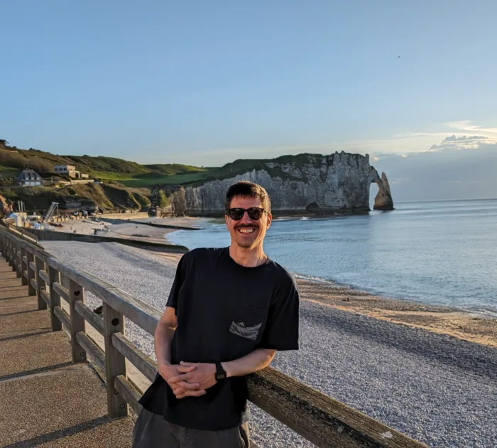

# Francisco Cardoso — Portfolio

Personal portfolio at **[franciscocardoso.eu](https://franciscocardoso.eu)**: data solutions architecture, data products, AI integration and data visualization work.



## What's in it

- A filterable work gallery covering apps, data visualizations (D3.js and Tableau), prototypes and automation projects
- Project pages for the apps built in this portfolio: [Fallow](https://github.com/ffmc/fallow-stoic-app), [The Scramble Cook](https://github.com/ffmc/scramble-cook) and [What's Building](https://github.com/ffmc/whats-building)
- Scroll-driven navigation and a one-click contact action

## Tech

- React 18 and Vite
- Design tokens in `src/tokens.css`; the design system is documented in [`docs/design.md`](docs/design.md)
- Deployed to GitHub Pages with a custom domain by a GitHub Actions workflow on every push to `main`

## Run locally

```bash
npm install
npm run dev      # http://localhost:5173
npm run build    # production build in dist/
```

## Structure

| Path | Purpose |
|---|---|
| `src/projects.js` | Work gallery content |
| `src/config.js` | Name, contact and social links |
| `src/components/` | Nav, About, WorkGallery, Contact, Footer |
| `public/` | Static assets and standalone project pages |
| `.github/workflows/deploy.yml` | Build and deploy to GitHub Pages |
